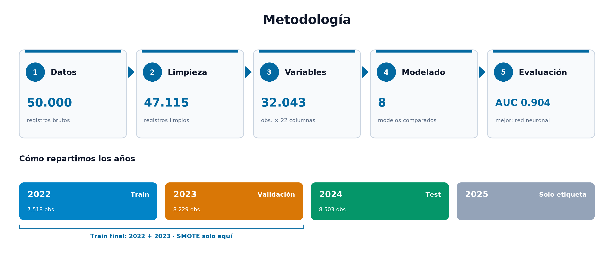
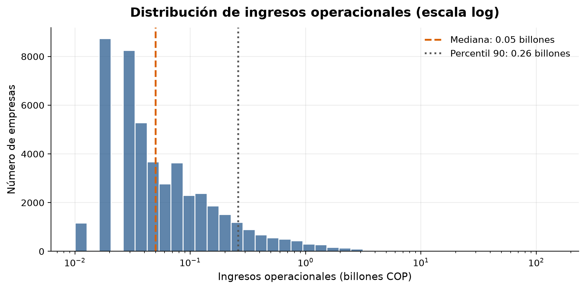
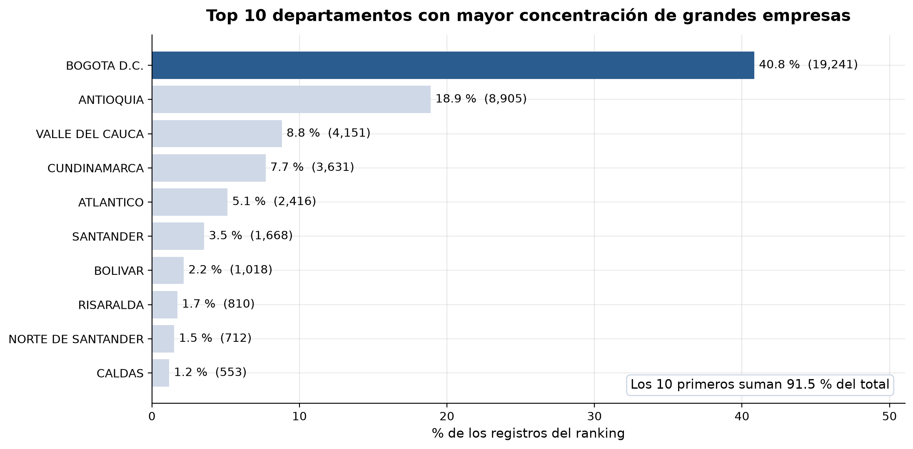
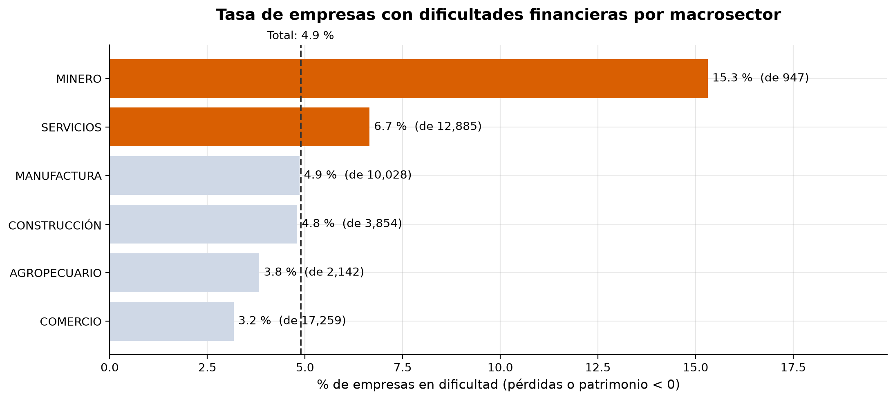
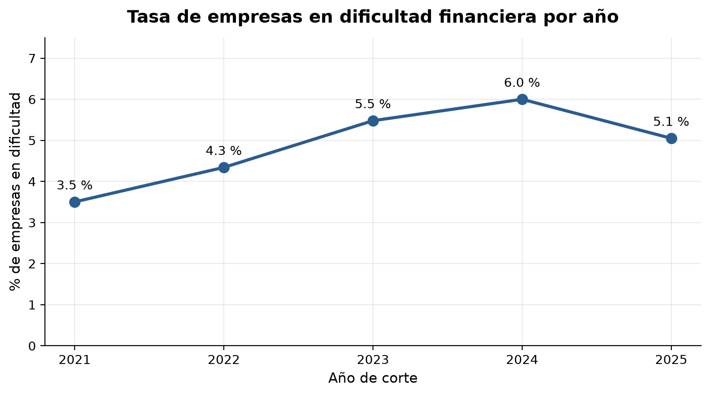
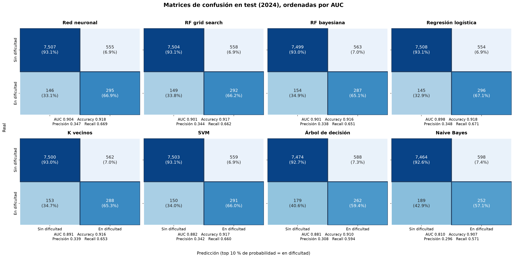

# Alerta temprana de dificultades financieras

**¿Qué grandes empresas colombianas tendrán pérdidas o patrimonio negativo el próximo año?**
Lo predecimos con los datos públicos de las [10.000 Empresas más Grandes del País](https://www.datos.gov.co/Comercio-Industria-y-Turismo/10-000-Empresas-mas-Grandes-del-Pa-s/6cat-2gcs/about_data) (2021-2025), pensando en entidades de supervisión como la Superintendencia de Sociedades.

> Revisando solo al **10 %** de empresas con mayor riesgo se detectan **2 de cada 3** casos de dificultad, **un año antes**.



## Cómo ejecutarlo

Solo necesitas [uv](https://docs.astral.sh/uv/):

```bash
uv sync
uv run jupyter lab
```

Ejecuta los notebooks de `notebooks/` en orden. La primera vez el CSV se descarga solo.

| Notebook | Qué hace |
|---|---|
| `01_exploracion` | Primer vistazo a los datos |
| `02_limpieza` | Limpia y guarda los datos |
| `03_visualizaciones` | Genera las gráficas de `figures/` |
| `04_modelado` | Entrena y compara los modelos |

## Lo que muestran los datos

<table>
<tr>
<td width="50%"><br><b>Pocas empresas concentran casi todo.</b> Las 100 más grandes se llevan más de un tercio de los ingresos.</td>
<td width="50%"><br><b>Bogotá y Antioquia</b> reúnen 6 de cada 10 grandes empresas.</td>
</tr>
<tr>
<td><br><b>La minería</b> tiene 5 veces más dificultades que el comercio (15,3 % frente a 3,2 %).</td>
<td><br><b>Sigue el ciclo económico:</b> del 3,5 % en 2021 al 6,0 % en 2024.</td>
</tr>
</table>

Y **la dificultad se repite**: el 56,8 % de las empresas en problemas sigue así al año siguiente, mientras que solo el 2,7 % de las sanas cae.

## ¿Se puede anticipar?

Sí. Los modelos aprendieron con 2022-2023 y se probaron con 2024, un año que nunca vieron.

| Modelo | AUC | Casos detectados |
|---|:---:|:---:|
| Red neuronal | 0,904 | 66,9 % |
| Random forest | 0,901 | 66,2 % |
| Regresión logística | 0,898 | 67,1 % |
| K vecinos | 0,891 | 65,3 % |
| SVM | 0,882 | 66,0 % |
| Árbol de decisión | 0,881 | 59,4 % |
| Naive Bayes | 0,810 | 57,1 % |

<sub>AUC: 0,5 es azar y 1 es perfecto.</sub>



## Conclusiones

- **Funciona como alerta temprana:** revisar 1 de cada 10 empresas anticipa 2 de cada 3 casos.
- **Cada alerta vale 7 veces más** que elegir una empresa al azar (34,7 % frente a 5,2 %).
- **Un modelo simple basta:** la regresión logística queda casi igual que la red neuronal y es más fácil de explicar.
- **Ojo con la minería** y con las empresas que ya tienen pérdidas.

**Limitaciones:** solo el 42 % de las empresas aparece los 5 años, las cifras vienen redondeadas, Supersalud queda fuera y hay un solo año de prueba.

## Estructura

```
notebooks/   Los 4 notebooks del análisis
src/         Funciones reutilizables
figures/     Gráficas finales
docs/        Póster y diagrama del pipeline
data/        raw (CSV original) y processed (se regeneran)
```
